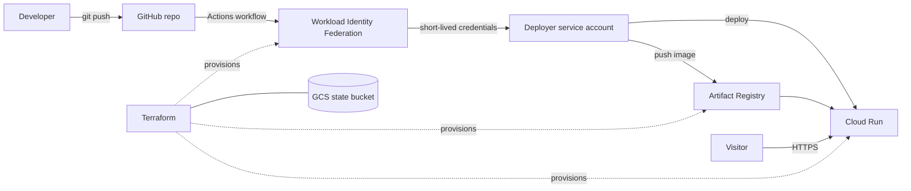

# Static Site on Google Cloud Run


A static website deployed to Cloud Run with Terraform and an automated GitHub Actions pipeline. Live at: **https://static-site-lzaavhwlpq-uc.a.run.app/**

## Architecture



## What it does

- Serves a containerized static site (nginx) on Cloud Run over HTTPS
- Infrastructure is defined in Terraform (the state bucket and API enablement are bootstrapped manually), with state stored in a versioned GCS bucket
- Every push to `main` that changes the site or Dockerfile builds a new image, tags it with the commit SHA, and deploys it
- GitHub authenticates to Google Cloud with Workload Identity Federation, so there are no long-lived service account keys

## Tech stack

Google Cloud Run, Artifact Registry, IAM, Workload Identity Federation, Terraform, Docker, nginx, GitHub Actions

## Design decisions

- **Cloud Run instead of a load balancer + bucket:** scales to zero, so an idle site costs nothing, and HTTPS is included. (A load balancer adds a fixed monthly cost.)
- **Keyless authentication:** no credentials stored in GitHub. Access is limited to this specific repository.
- **Least privilege:** the deployer service account can only push to one registry, update one service, and act as the runtime account.
- **Non-root container image:** runs as an unprivileged user on port 8080.
- **Remote state with versioning:** protects against state loss and supports teamwork.
- **Max 2 instances:** a cost guardrail.
- **Commit-SHA image tags:** every deployment traces back to the exact code that produced it.
- **Terraform ignores the running image:** the pipeline owns deployments, Terraform owns the infrastructure.

## Deploying it yourself

1. Create a GCP project, link billing, and enable the APIs:
   ```bash
   gcloud services enable run.googleapis.com artifactregistry.googleapis.com \
     iam.googleapis.com iamcredentials.googleapis.com \
     cloudresourcemanager.googleapis.com sts.googleapis.com
   ```
2. Create a versioned GCS bucket for Terraform state
3. Copy `terraform/terraform.tfvars.example` to `terraform/terraform.tfvars` and fill in your values
4. Initialize and create the image registry first:
   ```bash
   cd terraform
   terraform init -backend-config="bucket=YOUR-STATE-BUCKET"
   terraform apply -target=google_artifact_registry_repository.site
   ```
5. Build and push an initial `v1` image to Artifact Registry (the Cloud Run service needs one to exist)
   gcloud auth configure-docker us-central1-docker.pkg.dev
   docker build -t us-central1-docker.pkg.dev/YOUR-PROJECT-ID/site/static-site:v1 .
   docker push us-central1-docker.pkg.dev/YOUR-PROJECT-ID/site/static-site:v1
7. Run `terraform apply` for the rest of the infrastructure
8. Add `WIF_PROVIDER`, `WIF_SERVICE_ACCOUNT`, and `GCP_PROJECT_ID` as GitHub repository secrets (values come from `terraform output`)

## Challenges and what I learned

- **Terraform wasn't preinstalled in Cloud Shell.** The suggested `apt` install would have been lost when the session reset, so I installed the binary into my home directory and added it to my PATH so it persists.
- **Billing had to exist before I could enable APIs.** My account had no billing account yet, so enabling services failed until I created one and linked it to the project.
- **A multi-line command failed when pasted.** The `gcloud services enable` command errored because the line continuations broke. Running it as a single line fixed it, and I now paste long commands that way.
- **My first budget alert wouldn’t have warned me. By default it subtracted free-trial credits from the total, so it would have stayed quiet while credits covered my usage. I unchecked the credits so it tracks gross usage.


## Cost

Runs within Cloud Run's free tier at portfolio traffic levels. Actual spend as of November 13, 2026: $0.00.

## Future improvements

- Use a dedicated runtime service account for Cloud Run instead of the default compute account, with only the permissions the app needs
- Add a custom domain and managed certificate
- Run `terraform fmt`, `validate`, and `plan` on pull requests
- Add uptime checks, alerting, and an SLO with Cloud Monitoring
- https://github.com/akmiranda305-CloudEng/gcp-cloudrun-monitoring

## Teardown


`terraform destroy` removes everything Terraform manages (the Cloud Run service, Artifact Registry, and the identity setup). The state bucket, enabled APIs, and billing budget were created manually and need to be removed separately. Delete the state bucket last, since Terraform needs it to run `destroy`.

Note: deleted Workload Identity pools are held for 30 days, so use a new pool ID if you recreate it soon after.
